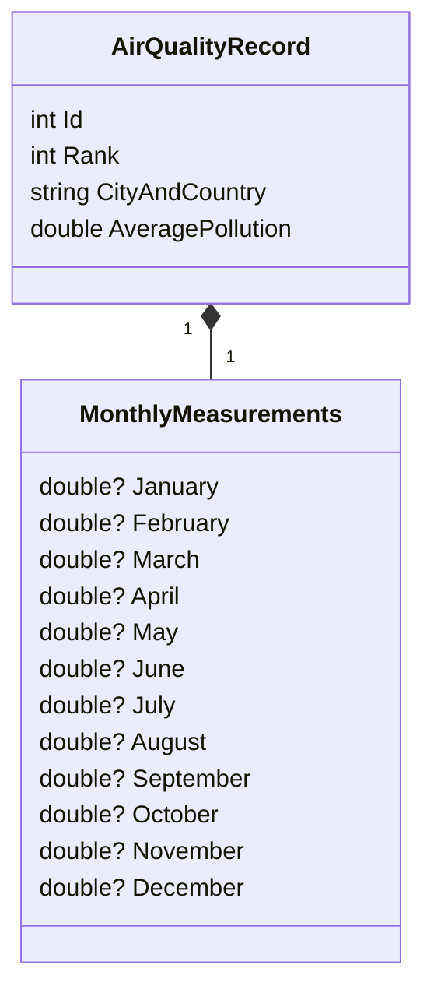

# Лабораторні роботи C# · 2026–2027

Лабораторна №1 складається з двох незалежних застосунків на ASP.NET Core з вебінтерфейсами.

```text
Solution
└── src/lab1
    ├── Task1
    │   ├── FolderSync.Domain
    │   ├── FolderSync.Application
    │   ├── FolderSync.Infrastructure
    │   ├── FolderSync.WebApi
    │   └── FolderSync.Front
    └── Task2
        ├── lab1.Domain
        ├── lab1.Application
        ├── lab1.Infrastructure
        ├── lab1.WebApi
        └── lab1.Front
```

Завдання 1: аналіз і синхронізація нових, змінених та видалених файлів; напрямки A → B, B → A, двостороннє об’єднання. У двосторонньому режимі відсутні файли копіюються, для змінених обирається новіший файл; за однакового часу — версія A.

Завдання 2: імпорт і експорт CSV/JSON/XML/XLSX, попередній перегляд, валідація, редагування, фільтри, сортування, групування, три графіки та звіти XLSX/DOCX. Датасет — показники забруднення повітря у 5 377 містах.

Інструкції запуску та перевірки: [RUNNING.md](RUNNING.md). Кожен WebApi сам обслуговує свій Front; JavaScript написаний без фреймворків.

У кожному застосунку Domain містить моделі, Application — операції над ними, Infrastructure — доступ до даних, WebApi — HTTP-контролери. Інтерфейс викликає API; обчислення й валідація виконуються на .NET.

Модель другого завдання:



Технології: .NET 10, CsvHelper, System.Text.Json, XML, ClosedXML, Open XML SDK, ScottPlot.

Авторка: Дацька Карина Богданівна, КН-21, Національний університет «Острозька академія».
