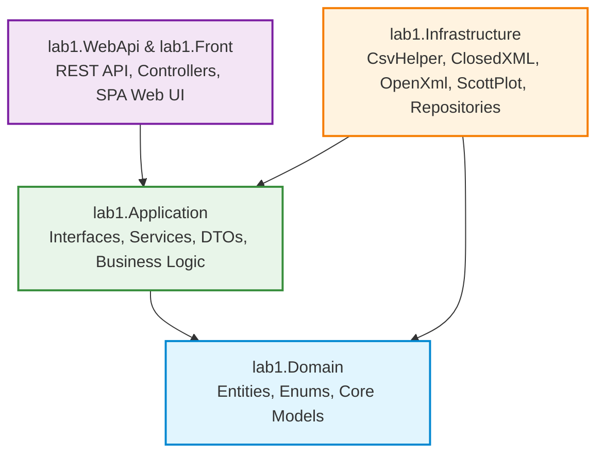

<p align="center">
  
</p>

<h1 align="center">C# (.NET 10) Laboratory Works — File System, Data Processing & Analytics</h1>

<p align="center">
  <b>Репозиторій лабораторних робіт з курсу «Програмування мовою C# (.NET)»</b><br/>
  Національний університет «Острозька академія» • Факультет романо-германських мов / Економічний факультет (Комп'ютерні науки)
</p>

<p align="center">
  
  
  
  
  
</p>

---

## 👩‍🎓 Автор роботи

- **Студентка:** Дацька Карина Богданівна
- **Група:** КН-21
- **Дисципліна:** Програмування мовою C# (.NET)
- **Звіти до робіт:**
  - 📄 [**Звіт до Лабораторної роботи №1 (Синхронізація папок)**](docs/Lab1_Report.md)
  - 📊 [**Звіт до Лабораторної роботи №2 (Файли, Дані, Графіки та Звіти)**](docs/Lab2_Report.md)

---

## 📖 Огляд проєкту

Даний репозиторій містить комплексне програмне рішення на базі **.NET 10**, яке реалізує завдання двох лабораторних робіт відповідно до інженерних практик **Clean Architecture (Чиста архітектура)**:

1. **Лабораторна робота №1: Синхронізація каталогів файлової системи**
   - Двосторонній та односторонній аналіз відмінностей між двома довільними папками.
   - Відстеження нових (`New`), змінених за датою UTC (`Modified`) та видалених (`Deleted`) файлів.
   - Вибір напрямку синхронізації: `SourceToTarget`, `TargetToSource`, `Bidirectional`.
   - Вбудований генератор тестових структур каталогів і файлів (`TestFileGenerator`).

2. **Лабораторна робота №2: Робота з різнорідними форматами даних, аналітика, візуалізація та генерація ділових звітів**
   - **Датасет:** Глобальний моніторинг індексу якості повітря (World Air Quality / IQAir PM2.5 Global Dataset) — **5 377 міст**, 15 стовпців.
   - **Імпорт та Експорт:** Потокова обробка форматів **CSV**, **JSON**, **XML**, **XLSX**.
   - **Чистка та нормалізація:** Захисний парсинг пропусків (`"-"` у `null`), усунення дублікатів, підтримка `CultureInfo.InvariantCulture`.
   - **Аналітика та фільтрація:** Пошук за містом/країною, діапазонами рейтингу та забруднення, обчислення метрик: сума, медіана, мінімум, максимум, розбиття на категорії безпеки.
   - **Візуалізація (ScottPlot 5):** Фонова генерація 3 видів діаграм (стовпчаста, кругова часток, лінійний помісячний тренд) з експортом у PNG.
   - **Ділові звіти:**
     - 📗 **XLSX-звіт** (`ClosedXML`) — аркуш із повним датасетом у зебра-стилі та аркуш зведеної аналітики (`Summary`).
     - 📘 **DOCX-звіт** (`DocumentFormat.OpenXml`) — офіційно оформлений звіт за стандартами (титульна сторінка, реквізити, аналітичні таблиці, вбудовані графіки з підписами).
   - **Клієнтський вебінтерфейс:** Повнофункціональний SPA на чистому HTML5/CSS3/JavaScript (`lab1.Front`), що роздається безпосередньо з вебсервера.

---

## 🏛️ Архітектура рішення

Проєкт побудований на 4 розділених проєктах у рішенні з чітким розмежуванням відповідальності:



### Структура компонентів

```
cshars_labs_2026-2027/
│
├── docs/                               # Офіційні звіти до лабораторних робіт
│   ├── Lab1_Report.md                  # Звіт до ЛР1: Синхронізація папок
│   └── Lab2_Report.md                  # Звіт до ЛР2: Робота з даними, звіти, графіки
│
├── src/
│   └── lab1/
│       ├── lab1.Domain/                # Рівень предметної області (чистий C#)
│       │   ├── Entities/               # AirQualityRecord, MonthlyMeasurements, SyncItem
│       │   └── Enums/                  # DataFormat, FileChangeType, SyncDirection, Sort...
│       │
│       ├── lab1.Application/           # Рівень бізнес-правил та контрактів
│       │   ├── DTOs/                   # AirQualityDto, ReportDataDto, ReportMetadataDto...
│       │   ├── Repositories/           # Інтерфейси сховищ, провайдерів звітів та графіків
│       │   └── Services/               # Csv/Json/Xml/Xlsx сервіси, DataAnalyticsService...
│       │
│       ├── lab1.Infrastructure/        # Рівень реалізації зовнішніх провайдерів
│       │   ├── Data/                   # Вхідні датасети (aqi_data.csv, air_quality.*)
│       │   └── Repositories/           # ClosedXML, ScottPlot, OpenXml, CsvHelper адаптери
│       │
│       ├── lab1.WebApi/                # ASP.NET Core REST API
│       │   ├── Controllers/            # Контролери для даних, звітів, графіків, синхронізації
│       │   ├── Reports/Charts/         # Автоматично згенеровані PNG графіки
│       │   └── Program.cs              # DI-конфігурація, CORS, роздача клієнта
│       │
│       └── lab1.Front/                 # Інтерактивна клієнтська веб-панель
│           ├── index.html              # Розмітка 5 вкладок (Дані, Імпорт, Графіки, Звіти, Синхронізація)
│           ├── style.css               # Сучасний адаптивний UI
│           └── main.js                 # Асинхронна робота з REST API
│
└── README.md
```

---

## 🛠️ Використані бібліотеки та технології

| Бібліотека / Технологія | Версія | Призначення |
| :--- | :--- | :--- |
| **.NET 10 & C# 13** | `10.0` | Базова платформа розробки |
| **ASP.NET Core Web API** | `10.0` | Побудова REST API ендпоінтів |
| **CsvHelper** | `33.0.1` | Потоковий високошвидкісний ввід/вивід CSV-файлів |
| **ClosedXML** | `0.104.2` | Обробка електронних таблиць Excel (.xlsx) та оформлення звітів |
| **DocumentFormat.OpenXml**| `3.1.1` | Генерація документів Microsoft Word (.docx) за стандартами |
| **ScottPlot** | `5.0.47` | Фонова програмна побудова діаграм та збереження в PNG |
| **NSwag & OpenAPI** | `14.2.0` | Генерація інтерактивної документації Swagger UI |

---

## 🚀 Встановлення та запуск

### 1. Клонування репозиторію
```bash
git clone https://github.com/KarinaDatska/csharp-labs-2026-2027.git
cd csharp-labs-2026-2027
```

### 2. Відновлення залежностей та збірка
```bash
dotnet restore
dotnet build
```

### 3. Запуск застосунку
```bash
dotnet run --project src/lab1/lab1.WebApi/lab1.WebApi.csproj
```

### 4. Доступ до вебінтерфейсу
Після старту вебсервера перейдіть за адресою:
- 🌐 **Клієнтський вебінтерфейс (SPA):** [http://localhost:5112/](http://localhost:5112/)
- 📑 **Swagger UI документація API:** [http://localhost:5112/swagger](http://localhost:5112/swagger)

---

## 📡 Огляд API ендпоінтів

### 🔹 Лабораторна робота №1: Синхронізація папок
- `POST /api/v1/folder-sync/analyze` — попередній аналіз відмінностей між двома папками (повертає перелік файлів зі статусами `New`, `Modified`, `Deleted`).
- `POST /api/v1/folder-sync/execute` — виконання синхронізації згідно з обраним напрямком.
- `POST /api/v1/test-files/generate` — генерація тестових каталогів та файлів з різними часовими мітками.

### 🔹 Лабораторна робота №2: Імпорт, Експорт, Аналітика та Звіти
- **Імпорт файлів:**
  - `POST /api/v2/csv/import` — імпорт CSV (`aqi_data.csv`).
  - `POST /api/v2/json/import` — імпорт JSON (`air_quality.json`).
  - `POST /api/v2/xml/import` — імпорт XML (`air_quality.xml`).
  - `POST /api/v2/xlsx/import` — імпорт Excel XLSX (`air_quality.xlsx`).
- **Експорт даних:**
  - `GET /api/v2/csv/export` — скачування актуального датасету в CSV.
  - `GET /api/v2/json/export` — скачування в JSON.
  - `GET /api/v2/xml/export` — скачування в XML.
  - `GET /api/v2/xlsx/export` — скачування в XLSX.
- **Аналітика та фільтрація:**
  - `GET /api/v2/records` — отримання всіх записів.
  - `GET /api/v2/records/search?city=Kyiv` — пошук за назвою міста або країни.
  - `GET /api/v2/records/filters` — фільтрація за містом, рейтингом та діапазоном забруднення.
  - `GET /api/v2/records/sort` — сортування за полями (Rank, City, AveragePollution).
  - `GET /api/v2/records/analytics/sum` — сумарний рівень забруднення.
  - `GET /api/v2/records/analytics/median` — медіанне значення.
  - `GET /api/v2/records/analytics/min` — місто з найчистішим повітрям.
  - `GET /api/v2/records/analytics/max` — найбільш забруднене місто.
  - `GET /api/v2/records/analytics/count` — загальна кількість записів.
- **Графіки ScottPlot (PNG):**
  - `GET /api/v2/charts/top-polluted` — стовпчаста діаграма Топ-10 найбільш забруднених міст.
  - `GET /api/v2/charts/distribution` — кругова діаграма розподілу міст за категоріями якості.
  - `GET /api/v2/charts/monthly-trend` — лінійний графік помісячної динаміки забруднення.
- **Генерація офіційних звітів:**
  - `GET /api/v2/reports/xlsx` — формування та скачування зведеного Excel-звіту.
  - `POST /api/v2/reports/docx` — формування офіційного Word-звіту за наданими метаданими студента.

---

## 📊 Візуалізація даних та приклади графіків

| Тип діаграми | Опис | Шлях до файлу |
| :--- | :--- | :--- |
| **Стовпчаста діаграма** | Рейтинг топ-10 найбільш забруднених міст за PM2.5 | [`docs/charts/top-polluted.png`](docs/charts/top-polluted.png) |
| **Кругова діаграма** | Відсотковий розподіл міст за категоріями безпеки | [`docs/charts/distribution.png`](docs/charts/distribution.png) |
| **Лінійний тренд** | Сезонні коливання концентрації часток за 12 місяців | [`docs/charts/monthly-trend.png`](docs/charts/monthly-trend.png) |

---

## 📜 Ліцензія

Проєкт розповсюджується під ліцензією [MIT](LICENSE).
