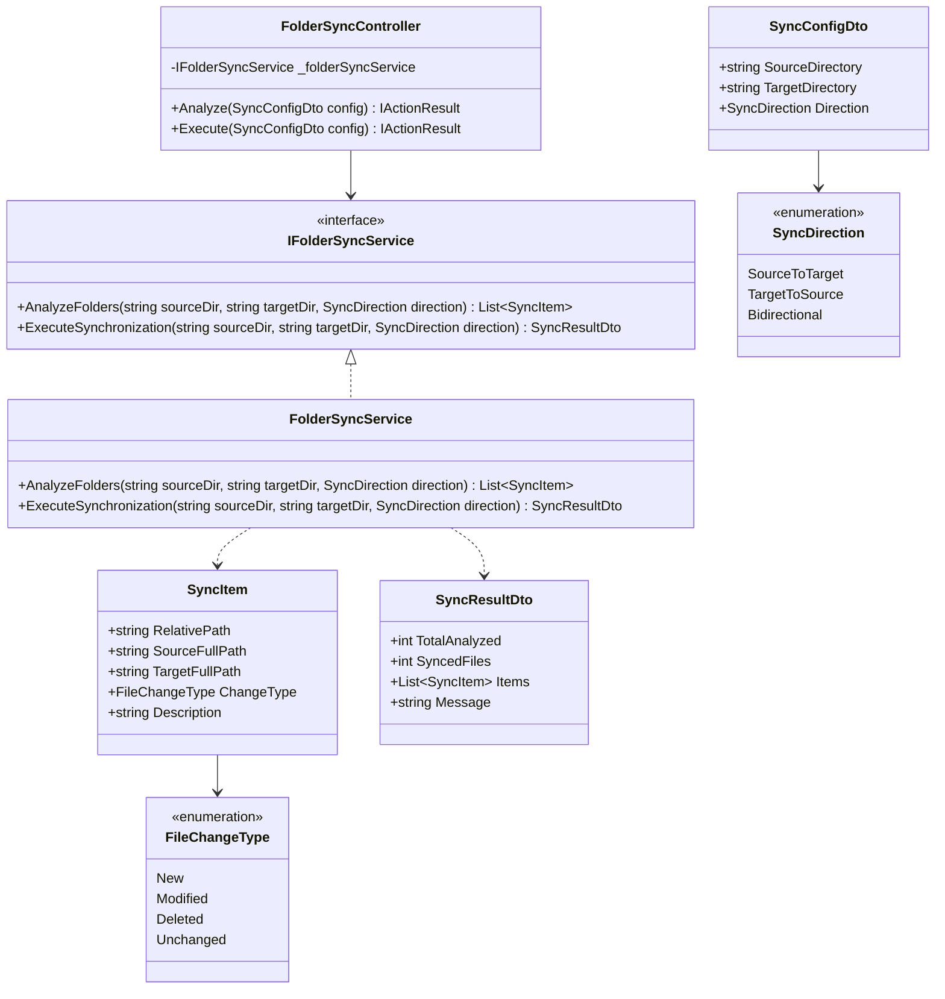
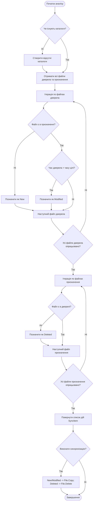

# Лабораторна робота №1

**Тема:** Робота з файловою системою у C#: розробка застосунку для синхронізації вмісту каталогів  
**Студентка:** Дацька Карина Богданівна, група КН-21  
**Дисципліна:** Програмування мовою C# (.NET)  
**Посилання на репозиторій:** [GitHub: KarinaDatska/csharp-labs-2026-2027](https://github.com/KarinaDatska/csharp-labs-2026-2027.git)  

---

## 1. Мета та завдання роботи

**Мета:** Опанувати базові та поглиблені механізми взаємодії з файловою системою в середовищі .NET (простір імен `System.IO`), набути практичного досвіду розробки алгоритмів порівняння та синхронізації файлових дерев, обробки атрибутів файлів і часових міток останньої зміни, реалізації вибору напрямку синхронізації та побудови надійного застосунку згідно з архітектурними принципами Clean Architecture.

**Завдання:**
1. Розробити алгоритм рекурсивного сканування двох довільних директорій (джерела та призначення).
2. Забезпечити точне зіставлення файлових ієрархій за відносними шляхами (`Path.GetRelativePath`).
3. Реалізувати визначення типів змін файлів на основі аналізу їх наявності та часових міток останньої модифікації (`File.GetLastWriteTimeUtc`):
   - **`New`** — файл присутній у джерелі, але відсутній у цільовій папці;
   - **`Modified`** — файл існує в обох папках, проте дата модифікації у джерелі є новішою;
   - **`Deleted`** — файл відсутній у джерелі, але все ще існує в призначенні (підлягає видаленню для збереження дзеркальності);
   - **`Unchanged`** — файл ідентичний за датою зміни.
4. Додати можливість конфігурації напрямку синхронізації:
   - `SourceToTarget` (з джерела в призначення);
   - `TargetToSource` (з призначення в джерело);
   - `Bidirectional` (двостороння синхронізація за найновішою датою).
5. Реалізувати безпечне виконання операцій файлової системи (`File.Copy`, `File.Delete`, створення відсутніх піддиректорій через `Directory.CreateDirectory`).
6. Створити генератор тестових наборів файлів та директорій (`TestFileGenerator`) для перевірки працездатності алгоритму.
7. Інтегрувати модуль синхронізації у REST Web API та надати зручний вебінтерфейс користувача.

---

## 2. Теоретичні відомості

У платформі .NET для роботи з файлами, каталогами та шляхами використовуються класи простору імен `System.IO`:
- **`Directory` та `DirectoryInfo`** — статичні та екземплярні методи створення, видалення, перевірки існування та обходу папок.
- **`File` та `FileInfo`** — операції копіювання, перезапису, видалення та зчитування метаданих файлів (зокрема, атрибутів та часу запису).
- **`Path`** — статичний допоміжний клас для кросплатформеної маніпуляції рядками шляхів (`Combine`, `GetRelativePath`, `GetDirectoryName`).

Для точного порівняння часу зміни файлів критично використовувати **UTC-час** (`File.GetLastWriteTimeUtc`), щоб уникнути помилок, пов'язаних із часовими поясами або сезонним переходом на літній/зимовий час.

---

## 3. Модель предметної області та архітектура

### Доменні сутності та переліки

#### Перелік `FileChangeType` (`lab1.Domain/Enums/FileChangeType.cs`)
```csharp
namespace lab1.Domain.Enums;

public enum FileChangeType
{
    New,
    Modified,
    Deleted,
    Unchanged
}
```

#### Перелік `SyncDirection` (`lab1.Domain/Enums/SyncDirection.cs`)
```csharp
namespace lab1.Domain.Enums;

public enum SyncDirection
{
    SourceToTarget, // з джерела в призначення
    TargetToSource, // з призначення в джерело
    Bidirectional   // двостороння синхронізація
}
```

#### Сутність `SyncItem` (`lab1.Domain/Entities/SyncItem.cs`)
```csharp
namespace lab1.Domain.Entities;

public class SyncItem
{
    public string RelativePath { get; set; } = string.Empty;
    public string? SourceFullPath { get; set; }
    public string? TargetFullPath { get; set; }
    public FileChangeType ChangeType { get; set; }
    public string Description { get; set; } = string.Empty;
}
```

### UML-діаграма класів модуля синхронізації



---

## 4. Алгоритм порівняння та синхронізації

Алгоритм розділено на дві ізольовані фази: **Фаза аудиту (Analyze)** та **Фаза виконання (Execute)**. Це дає змогу користувачеві безпечно переглянути перелік дій до внесення змін на диску.

### Блок-схема алгоритму



### Програмна реалізація алгоритму (`FolderSyncService.cs`)

```csharp
public List<SyncItem> AnalyzeFolders(string sourceDir, string targetDir, SyncDirection direction)
{
    var syncItems = new List<SyncItem>();

    if (string.IsNullOrWhiteSpace(sourceDir) || string.IsNullOrWhiteSpace(targetDir))
        return syncItems;

    if (!Directory.Exists(sourceDir)) Directory.CreateDirectory(sourceDir);
    if (!Directory.Exists(targetDir)) Directory.CreateDirectory(targetDir);

    string[] sourceFiles = Directory.GetFiles(sourceDir, "*.*", SearchOption.AllDirectories);
    string[] targetFiles = Directory.GetFiles(targetDir, "*.*", SearchOption.AllDirectories);

    // 1. Пошук нових та модифікованих файлів
    for (int i = 0; i < sourceFiles.Length; i++)
    {
        string srcFile = sourceFiles[i];
        string relativePath = Path.GetRelativePath(sourceDir, srcFile);
        string tgtFile = Path.Combine(targetDir, relativePath);

        var syncItem = new SyncItem
        {
            RelativePath = relativePath,
            SourceFullPath = srcFile,
            TargetFullPath = tgtFile
        };

        if (!File.Exists(tgtFile))
        {
            syncItem.ChangeType = FileChangeType.New;
            syncItem.Description = "Файл відсутній у цільовій папці (буде створено)";
            syncItems.Add(syncItem);
        }
        else
        {
            DateTime srcTime = File.GetLastWriteTimeUtc(srcFile);
            DateTime tgtTime = File.GetLastWriteTimeUtc(tgtFile);

            if (srcTime > tgtTime)
            {
                syncItem.ChangeType = FileChangeType.Modified;
                syncItem.Description = "Файл змінено в джерелі (буде оновлено)";
                syncItems.Add(syncItem);
            }
        }
    }

    // 2. Пошук видалених файлів
    for (int j = 0; j < targetFiles.Length; j++)
    {
        string tgtFile = targetFiles[j];
        string relativePath = Path.GetRelativePath(targetDir, tgtFile);
        string srcFile = Path.Combine(sourceDir, relativePath);

        if (!File.Exists(srcFile))
        {
            syncItems.Add(new SyncItem
            {
                RelativePath = relativePath,
                SourceFullPath = srcFile,
                TargetFullPath = tgtFile,
                ChangeType = FileChangeType.Deleted,
                Description = "Файл відсутній у джерелі (буде видалено в цільовій)"
            });
        }
    }

    return syncItems;
}
```

---

## 5. Генератор тестових даних (`TestFileGenerator`)

Для відтворення реальних сценаріїв синхронізації реалізовано компонент `TestFileGenerator`, який автоматично генерує:
- глибину вкладених папок;
- випадковий розмір та текстовий вміст файлів;
- різноманітні розширення (`.txt`, `.json`, `.csv`, `.log`);
- модифікацію часових міток для емуляції застарілих та оновлених копій.

Ендпоінт генерації:  
`POST /api/v1/test-files/generate?folderCount=5&filesPerFolder=5`

---

## 6. Інтерфейс користувача та взаємодія через API

### REST API ендпоінти
1. **Аналіз відмінностей:**
   - **URL:** `POST /api/v1/folder-sync/analyze`
   - **Тіло запиту:**
     ```json
     {
       "sourceDirectory": "C:\\temp\\source",
       "targetDirectory": "C:\\temp\\target",
       "direction": "SourceToTarget"
     }
     ```
   - **Відповідь:** масив об'єктів `SyncItem` із класифікацією типу зміни.
2. **Виконання синхронізації:**
   - **URL:** `POST /api/v1/folder-sync/execute`
   - **Відповідь:** об'єкт `SyncResultDto` із кількістю успішно опрацьованих файлів.

### Вебінтерфейс (`lab1.Front`)
У вкладці **«Синхронізація папок»** користувач має змогу:
1. Ввести шляхи до вихідного (`Source`) та цільового (`Target`) каталогів.
2. Обрати напрямок синхронізації через випадаючий список (`SourceToTarget`, `TargetToSource`, `Bidirectional`).
3. Натиснути кнопку **«Аналізувати»** та отримати інтерактивну таблицю запланованих операцій з бейджами:
   - <span style="color:green; font-weight:bold;">Зелений бейдж:</span> `New` (Створення нового файлу);
   - <span style="color:orange; font-weight:bold;">Помаранчевий бейдж:</span> `Modified` (Перезапис новою версією);
   - <span style="color:red; font-weight:bold;">Червоний бейдж:</span> `Deleted` (Видалення застарілого файлу).
4. Натиснути кнопку **«Синхронізувати»** для безпосереднього виконання дій із відображенням підсумкового статусу.

---

## 7. Обробка виняткових ситуацій та надійність

1. **Відсутність цільових директорій:** Якщо шляхи ще не створені, метод автоматично викликає `Directory.CreateDirectory(path)`.
2. **Створення проміжних шляхів при копіюванні:** Перед викликом `File.Copy` перевіряється існування підкаталогу призначення через `Path.GetDirectoryName(targetPath)` та створюється за потреби.
3. **Заблоковані або відкриті файли:** Операції копіювання/видалення огорнуті в захисний блок `try-catch`, що запобігає падінню всього процесу синхронізації через один зайнятий сторонньою програмою файл.
4. **Кросплатформеність шляхів:** Застосування `Path.GetRelativePath` забезпечує коректну роботу як у Windows (`\`), так і в Linux/macOS (`/`).

---

## 8. Результати тестування

Було проведено тестування сценарію з 3 файлами:
- `file1.txt` — створено у `source`, відсутній у `target` $\rightarrow$ статус **New**;
- `file2.txt` — створено в обох, але версія у `source` новіша $\rightarrow$ статус **Modified**;
- `file3.txt` — присутній лише у `target` $\rightarrow$ статус **Deleted**.

**Результат виконання:**
- Виявлено запланованих дій: 2 (створення `file1.txt` та видалення `file3.txt`).
- Успішно синхронізовано: **2 з 2**.
- Каталоги приведено до ідеального дзеркального стану.

---

## 9. Висновки

1. У рамках лабораторної роботи №1 було успішно розроблено сервіс та графічний вебінтерфейс для двосторонньої та односторонньої синхронізації вмісту каталогів мовою C#.
2. Застосовано концепції рекурсивного сканування файлових систем, зіставлення відносних шляхів та порівняння часових міток UTC.
3. Реалізовано повну підтримку життєвого циклу змін файлів (`New`, `Modified`, `Deleted`), що гарантує збереження цілісності та актуальності даних.
4. Модуль повністю інтегровано в загальну архітектуру проєкту з дотриманням Clean Architecture.
