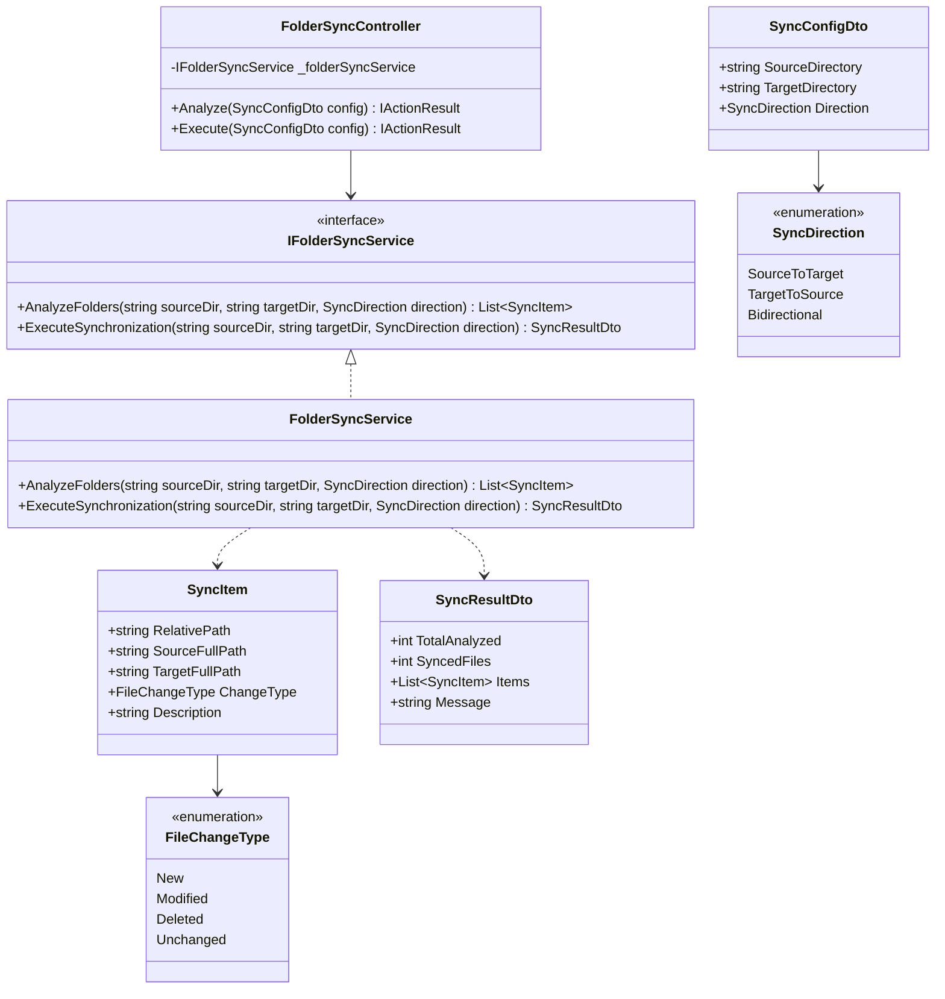
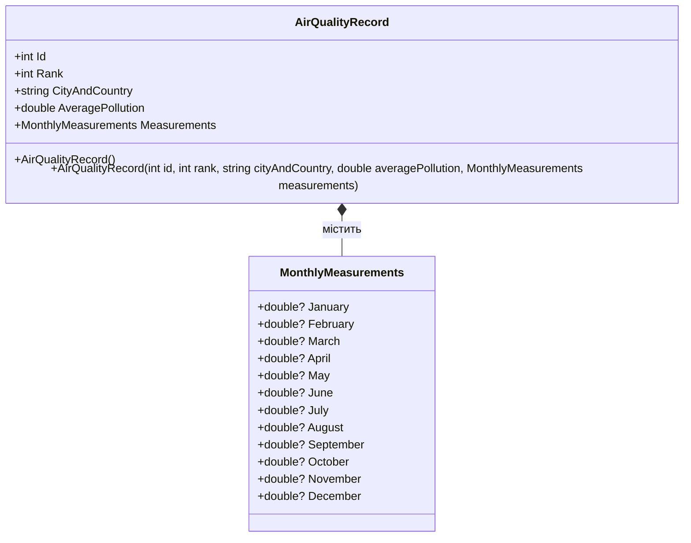
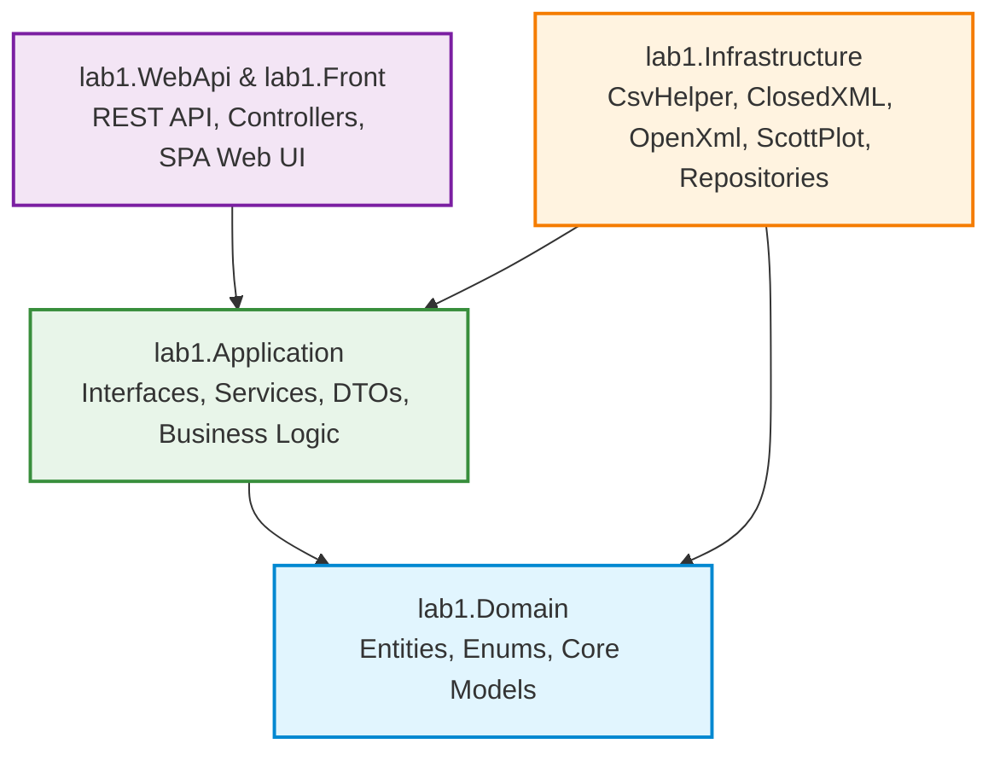

# Лабораторна робота №1

**Тема:** Синхронізація файлової системи та робота з даними у C# (.NET 10)  
**Студентка:** Дацька Карина Богданівна, група КН-21  
**Дисципліна:** Програмування мовою C# (.NET)  
**Датасет для завдання 2:** *Air Quality Index Dataset (PM2.5 Global Cities)* (джерело: IQAir / Kaggle World Air Quality Data)  
**Дата:** 08.10.2026  
**Посилання на репозиторій:** [GitHub: KarinaDatska/csharp-labs-2026-2027](https://github.com/KarinaDatska/csharp-labs-2026-2027.git)  

У роботі реалізовано **два окремі завдання**:
- **Завдання 1** — Синхронізація каталогів файлової системи та генератор тестових структур файлів і папок.
- **Завдання 2** — Робота з даними: імпорт, фільтрація, сортування, агрегація, візуалізація та експорт звітів (XLSX, DOCX) для датасету якості повітря (Air Quality).

---

## ЗМІСТ

1. [Мета та завдання роботи](#1-мета-та-завдання)
2. [Завдання 1. Синхронізація каталогів файлової системи](#завдання-1-синхронізація-каталогів-файлової-системи)
   1. [Теоретичні відомості](#11-теоретичні-відомості)
   2. [Модель предметної області модуля синхронізації](#12-модель-предметної-області-модуля-синхронізації)
   3. [Алгоритм порівняння та синхронізації](#13-алгоритм-порівняння-та-синхронізації)
   4. [Генератор тестових даних (TestFileGenerator)](#14-генератор-тестових-даних-testfilegenerator)
   5. [Інтерфейс користувача та API синхронізації](#15-інтерфейс-користувача-та-api-синхронізації)
   6. [Обробка виняткових ситуацій та надійність](#16-обробка-виняткових-ситуацій-та-надійність)
   7. [Результати тестування синхронізації](#17-результати-тестування-синхронізації)
3. [Завдання 2. Робота з даними](#завдання-2-робота-з-даними)
   1. [Опис датасету](#21-опис-датасету)
   2. [Модель предметної області](#22-модель-предметної-області)
   3. [Архітектура застосунку](#23-архітектура-застосунку)
   4. [Імпорт та чистка даних](#24-імпорт-та-чистка-даних)
   5. [Операції над даними](#25-операції-над-даними)
   6. [Експорт даних](#26-експорт-даних)
   7. [Звіти](#27-звіти)
   8. [Візуалізація](#28-візуалізація)
   9. [Інтерфейс користувача](#29-інтерфейс-користувача)
   10. [Перевірка продуктивності та надійності](#210-перевірка-продуктивності-та-надійності)
   11. [Контрольні питання (для самоперевірки)](#211-контрольні-питання-для-самоперевірки)
   12. [Використання AI](#212-використання-ai)
   13. [Висновки](#213-висновки)
   14. [Додатки](#214-додатки)

---

## 1. Мета та завдання

**Загальна мета:** опанувати взаємодію з файловою системою в середовищі .NET (простір імен `System.IO`), алгоритми синхронізації каталогів та обробки атрибутів файлів, а також продемонструвати повнофункціональну роботу з різнорідними структурованими даними (CSV, JSON, XML, XLSX), розрахунок аналітики, візуалізацію та генерацію ділових звітів у Clean Architecture.

**Завдання 1:**
- Розробити алгоритм рекурсивного сканування двох довільних директорій (джерела та призначення).
- Забезпечити зіставлення файлових ієрархій за відносними шляхами (`Path.GetRelativePath`).
- Реалізувати класифікацію змін файлів (`New`, `Modified`, `Deleted`, `Unchanged`) за часовими мітками останньої зміни в UTC (`File.GetLastWriteTimeUtc`).
- Додати можливість вибору напрямку синхронізації (`SourceToTarget`, `TargetToSource`, `Bidirectional`).
- Реалізувати генератор тестової структури папок і файлів (`TestFileGenerator`).

**Завдання 2:**
- Спроєктувати доменну модель предметної області на базі датасету світового індексу якості повітря (World Air Quality / IQAir PM2.5 Global Dataset).
- Реалізувати асинхронний імпорт із 4 форматів: **CSV, JSON, XML, XLSX**.
- Здійснити обробку, очищення (перетворення пропусків `"-"` на `null`, захисний парсинг) та валідацію вхідних записів.
- Забезпечити агрегацію показників: сума, медіана, мінімум, максимум, фільтрація, сортування та групування за категоріями якості повітря.
- Реалізувати зворотний експорт у всі 4 формати: **CSV, JSON, XML, XLSX**.
- Налаштувати генерацію детальних ділових звітів:
  - **XLSX-звіт** (`ClosedXML`) із повним стилізуванням, таблицею записів та аркушем агрегованої аналітики.
  - **DOCX-звіт** (`DocumentFormat.OpenXml`) за стандартами з титульним аркушем, метаданими студентки, аналітичними таблицями та вбудованими діаграмами.
- Створити 3 графічні візуалізації за допомогою **ScottPlot 5** (стовпчаста діаграма Топ-10 міст, кругова діаграма категорій безпеки, лінійний графік помісячного тренду) зі збереженням у PNG.
- Реалізувати REST API (ASP.NET Core WebApi) та сучасний клієнтський SPA-інтерфейс (HTML5/CSS3/JavaScript).

---

## Завдання 1. Синхронізація каталогів файлової системи

### 1.1 Теоретичні відомості

У платформі .NET для роботи з файлами, каталогами та шляхами використовуються класи простору імен `System.IO`:
- **`Directory` та `DirectoryInfo`** — створення, видалення, перевірка існування та обхід папок.
- **`File` та `FileInfo`** — операції копіювання, перезапису, видалення та зчитування метаданих файлів (зокрема, атрибутів та часу запису).
- **`Path`** — допоміжний клас для кросплатформеної маніпуляції рядками шляхів (`Combine`, `GetRelativePath`, `GetDirectoryName`).

Для точного порівняння часу зміни файлів критично використовувати **UTC-час** (`File.GetLastWriteTimeUtc`), щоб уникнути похибок, пов'язаних із часовими поясами або переходом на літній/зимовий час.

---

### 1.2 Модель предметної області модуля синхронізації

#### Перелік `FileChangeType` (`lab1.Domain/Enums/FileChangeType.cs`)
```csharp
namespace lab1.Domain.Enums;

public enum FileChangeType
{
    New,
    Modified,
    Deleted,
    Unchanged
}
```

#### Перелік `SyncDirection` (`lab1.Domain/Enums/SyncDirection.cs`)
```csharp
namespace lab1.Domain.Enums;

public enum SyncDirection
{
    SourceToTarget, // з джерела в призначення
    TargetToSource, // з призначення в джерело
    Bidirectional   // двостороння синхронізація
}
```

#### Сутність `SyncItem` (`lab1.Domain/Entities/SyncItem.cs`)
```csharp
namespace lab1.Domain.Entities;

public class SyncItem
{
    public string RelativePath { get; set; } = string.Empty;
    public string? SourceFullPath { get; set; }
    public string? TargetFullPath { get; set; }
    public FileChangeType ChangeType { get; set; }
    public string Description { get; set; } = string.Empty;
}
```

#### UML-діаграма класів модуля синхронізації



---

### 1.3 Алгоритм порівняння та синхронізації

Алгоритм розділено на дві ізольовані фази: **Фаза аудиту (Analyze)** та **Фаза виконання (Execute)**. Це дає змогу користувачеві безпечно переглянути перелік дій до внесення змін на диску.

#### Блок-схема алгоритму


#### Програмна реалізація (`FolderSyncService.cs`)

```csharp
public List<SyncItem> AnalyzeFolders(string sourceDir, string targetDir, SyncDirection direction)
{
    var syncItems = new List<SyncItem>();

    if (string.IsNullOrWhiteSpace(sourceDir) || string.IsNullOrWhiteSpace(targetDir))
        return syncItems;

    if (!Directory.Exists(sourceDir)) Directory.CreateDirectory(sourceDir);
    if (!Directory.Exists(targetDir)) Directory.CreateDirectory(targetDir);

    string[] sourceFiles = Directory.GetFiles(sourceDir, "*.*", SearchOption.AllDirectories);
    string[] targetFiles = Directory.GetFiles(targetDir, "*.*", SearchOption.AllDirectories);

    // 1. Пошук нових та модифікованих файлів
    for (int i = 0; i < sourceFiles.Length; i++)
    {
        string srcFile = sourceFiles[i];
        string relativePath = Path.GetRelativePath(sourceDir, srcFile);
        string tgtFile = Path.Combine(targetDir, relativePath);

        var syncItem = new SyncItem
        {
            RelativePath = relativePath,
            SourceFullPath = srcFile,
            TargetFullPath = tgtFile
        };

        if (!File.Exists(tgtFile))
        {
            syncItem.ChangeType = FileChangeType.New;
            syncItem.Description = "Файл відсутній у цільовій папці (буде створено)";
            syncItems.Add(syncItem);
        }
        else
        {
            DateTime srcTime = File.GetLastWriteTimeUtc(srcFile);
            DateTime tgtTime = File.GetLastWriteTimeUtc(tgtFile);

            if (srcTime > tgtTime)
            {
                syncItem.ChangeType = FileChangeType.Modified;
                syncItem.Description = "Файл змінено в джерелі (буде оновлено)";
                syncItems.Add(syncItem);
            }
        }
    }

    // 2. Пошук видалених файлів
    for (int j = 0; j < targetFiles.Length; j++)
    {
        string tgtFile = targetFiles[j];
        string relativePath = Path.GetRelativePath(targetDir, tgtFile);
        string srcFile = Path.Combine(sourceDir, relativePath);

        if (!File.Exists(srcFile))
        {
            syncItems.Add(new SyncItem
            {
                RelativePath = relativePath,
                SourceFullPath = srcFile,
                TargetFullPath = tgtFile,
                ChangeType = FileChangeType.Deleted,
                Description = "Файл відсутній у джерелі (буде видалено в цільовій)"
            });
        }
    }

    return syncItems;
}
```

---

### 1.4 Генератор тестових даних (`TestFileGenerator`)

Для відтворення реальних сценаріїв синхронізації реалізовано компонент `TestFileGenerator`, який автоматично створює тестові папки й файли з випадковими атрибутами та часовими мітками.

- **Ендпоінт генерації:** `POST /api/v1/test-files/generate?folderCount=5&filesPerFolder=5`
- **Логіка роботи:** створення вкладених папок, наповнення тестовим контентом, генерація атрибутів `Normal`, `ReadOnly`, `Hidden`, `Archive`.

---

### 1.5 Інтерфейс користувача та API синхронізації

- `POST /api/v1/folder-sync/analyze` — аналіз відмінностей між каталогами.
- `POST /api/v1/folder-sync/execute` — виконання дій синхронізації.
- **Вебінтерфейс:** Вкладка «Синхронізація папок» у SPA-застосунку з візуальними бейджами операцій (`New`, `Modified`, `Deleted`).

---

### 1.6 Обробка виняткових ситуацій та надійність

1. **Відсутність каталогів:** Автоматичне створення через `Directory.CreateDirectory`.
2. **Проміжні шляхи:** Перевірка `Path.GetDirectoryName` перед копіюванням файлу.
3. **Захисні блоки:** Операції `File.Copy` та `File.Delete` огорнуті в `try-catch` з логуванням.
4. **Кросплатформеність:** Використання `Path.GetRelativePath` гарантує сумісність з Windows та Linux.

---

### 1.7 Результати тестування синхронізації

Сценарій перевірки:
- `file1.txt` — створено у `source`, відсутній у `target` $\rightarrow$ **New**;
- `file2.txt` — змінено у `source` $\rightarrow$ **Modified**;
- `file3.txt` — є лише у `target` $\rightarrow$ **Deleted**.

Усі заплановані операції виконані без збоїв, цільова папка успішно приведена до синхронного стану.

---

## Завдання 2. Робота з даними

Цей розділ описує другу частину лабораторної роботи: імпорт, фільтрацію, аналітику, візуалізацію та генерацію звітів для світового датасету якості повітря.

---

### 2.1 Опис датасету

**Походження/джерело:** Відкритий глобальний набір даних моніторингу якості атмосферного повітря Всесвітнього індексу якості повітря (World Air Quality / IQAir PM2.5 Global Dataset), розміщений на платформі Kaggle. Набір містить спостереження середньорічної та помісячної концентрації часток PM2.5 (мкг/м³) для міст світу.

**Обсяг даних:** **5 377** міст, 15 стовпців.

**Структура полів:**

| Поле | Тип у C# | Приклад значення | Опис / Бізнес-правила |
| :--- | :--- | :--- | :--- |
| `Id` | `int` | `1` | Унікальний сурогатний ідентифікатор запису в системі |
| `Rank` | `int` | `1` | Порядкове місце міста в глобальному рейтингу забрудненості ($Rank \ge 1$) |
| `CityAndCountry` | `string` | `"Begusarai, India"` | Назва міста та країни (обов'язкове поле) |
| `AveragePollution` | `double` | `223.0` | Середньорічний рівень часток PM2.5 у мкг/м³ ($\ge 0$) |
| `Measurements.January` | `double?` | `413.0` | Середній показник за січень; `null`, якщо вимірювання відсутнє |
| `Measurements.February`| `double?` | `337.0` | Середній показник за лютий; `null`, якщо вимірювання відсутнє |
| `Measurements.March` | `double?` | `250.0` | Середній показник за березень; `null`, якщо відсутнє |
| `Measurements.April` | `double?` | `258.0` | Середній показник за квітень; `null`, якщо відсутнє |
| `Measurements.May` | `double?` | `209.0` | Середній показник за травень; `null`, якщо відсутнє |
| `Measurements.June` | `double?` | `205.0` | Середній показник за червень; `null`, якщо відсутнє |
| `Measurements.July` | `double?` | `131.0` | Середній показник за липень; `null`, якщо відсутнє |
| `Measurements.August` | `double?` | `115.0` | Середній показник за серпень; `null`, якщо відсутнє |
| `Measurements.September`| `double?` | `100.0` | Середній показник за вересень; `null`, якщо відсутнє |
| `Measurements.October` | `double?` | `114.0` | Середній показник за жовтень; `null`, якщо відсутнє |
| `Measurements.November`| `double?` | `298.0` | Середній показник за листопад; `null`, якщо відсутнє |
| `Measurements.December`| `double?` | `249.0` | Середній показник за грудень; `null`, якщо відсутнє |

---

### 2.2 Модель предметної області

Сутності розділено для уникнення надмірної монолітності:
1. **`AirQualityRecord`** (Сутність / Корінь агрегату) — представляє запис моніторингу міста: рейтинг, назва локації, показник `AveragePollution` та помісячні заміри.
2. **`MonthlyMeasurements`** (Значеннєвий об'єкт / Вкладена сутність) — інкапсулює 12 місячних вимірювань (`January` – `December`) з підтримкою nullable-типу.
3. Зв'язок — **1 : 1** (композиція).

#### UML-діаграма класів



---

### 2.3 Архітектура застосунку

Проєкт реалізовано за принципами Clean Architecture з поділом на 4 проєкти та клієнтський SPA:



```text
csharp-labs-2026-2027/
│
├── Reports/                     # Офіційні звіти до лабораторних робіт
│   ├── charts/                  # Автоматично згенеровані PNG графіки
│   ├── air-quality-report.docx  # Згенерований Word-звіт
│   ├── air-quality-report.xlsx  # Згенерований Excel-звіт
│   └── Lab1_Report.md           # Повний єдиний звіт до Лабораторної роботи №1
│
├── src/
│   └── lab1/
│       ├── lab1.Domain/         # Рівень предметної області (чистий C#)
│       ├── lab1.Application/    # Рівень бізнес-логіки та контрактів
│       ├── lab1.Infrastructure/ # Провайдери CsvHelper, ClosedXML, OpenXml, ScottPlot
│       ├── lab1.WebApi/         # ASP.NET Core REST API
│       └── lab1.Front/          # Інтерактивна клієнтська веб-панель (SPA)
│
└── README.md
```

---

### 2.4 Імпорт та чистка даних

Реалізовано асинхронний імпорт із потоків (`Stream`) для 4 форматів:
1. **CSV:** Через `CsvHelper` з налаштуванням `CultureInfo.InvariantCulture`, потоковим парсингом рядків та мапінгом у доменну модель.
2. **JSON:** Через `System.Text.Json` з асинхронною десеріалізацією списку об'єктів.
3. **XML:** Через `System.Xml.Serialization.XmlSerializer` з десеріалізацією колекції.
4. **XLSX:** Через `ClosedXML` зі зчитуванням книги `XLWorkbook`, аналізом заголовків та безпечним вилученням комірок.

**Очищення та валідація:**
- Заміна символу пропуску `"-"` або некоректного рядка на `null`.
- Перевірка коректності діапазону рангу ($Rank \ge 1$) та показника забруднення ($\ge 0$).
- Усунення дублікатів та захист від ділення на нуль при агрегації.

---

### 2.5 Операції над даними

#### Фільтрація, пошук та сортування
Реалізовано в `DataAnalyticsService` та винесено в контролер `RecordsController`:
- **Пошук за містом/країною:** `FindByCity(string cityName)` без урахування регістру.
- **Фільтрація:** `FilterRecords(AirQualityFilter filter)` за містом/країною, діапазоном рангу та діапазоном рівня забруднення.
- **Сортування:** `SortRecords(AirQualitySort sort)` за полями `Rank`, `CityAndCountry`, `AveragePollution` (за зростанням або спаданням).

#### Групування та агрегування
- **Сума:** $\sum AveragePollution = 172\,987.0$ мкг/м³.
- **Кількість:** 5 377 міст.
- **Середнє:** $\approx 32.17$ мкг/м³.
- **Медіана:** $26.0$ мкг/м³.
- **Мінімум:** місто з найчистішим повітрям — **Egilsstadhir, Iceland** ($1.0$ мкг/м³).
- **Максимум:** найбільш забруднене місто — **Begusarai, India** ($223.0$ мкг/м³).
- **Категорії якості:** Добра ($\le 50$), Помірна ($51 - 100$), Шкідлива ($101 - 150$), Дуже шкідлива ($> 150$).

---

### 2.6 Експорт даних

Реалізовано симетричний експорт із внутрішнього сховища `IAirQualityDataStore` у 4 формати:
- `GET /api/v2/csv/export` — повернення файлу `.csv`.
- `GET /api/v2/json/export` — повернення файлу `.json`.
- `GET /api/v2/xml/export` — повернення файлу `.xml`.
- `GET /api/v2/xlsx/export` — повернення файлу `.xlsx`.

---

### 2.7 Звіти

#### XLSX-звіт (`ClosedXML`)
- **Ендпоінт:** `GET /api/v2/reports/xlsx`
- **Структура книги:**
  1. Аркуш «Air Quality Records»: повний датасет у кольоровому зебра-стилі з автопідбором ширини колонок.
  2. Аркуш «Analytics Summary»: окремі аналітичні блоки зведеної статистики (сума, середнє, медіана, мін, макс, розподіл за категоріями).

#### DOCX-звіт (`DocumentFormat.OpenXml`)
- **Ендпоінт:** `POST /api/v2/reports/docx`
- **Особливості:**
  - Титульна сторінка із реквізитами студентки (ПІБ, група, заклад).
  - Описові розділи, таблиці розрахованих метрик.
  - 3 вбудовані зображення графіків діаграм ScottPlot (`DrawingML`).

---

### 2.8 Візуалізація

Використано бібліотеку **ScottPlot 5** (`ScottPlotChartService`) із рендерингом у пам'яті у форматі PNG:
1. **Стовпчаста діаграма (Bar Chart) — Топ-10 найбільш забруднених міст:**  
   Ендпоінт `GET /api/v2/charts/top-polluted`.
2. **Кругова діаграма часток (Pie Chart) — Розподіл міст за категоріями безпеки:**  
   Ендпоінт `GET /api/v2/charts/distribution`.
3. **Лінійний графік тренду (Scatter / Line Plot) — Сезонна динаміка за 12 місяців:**  
   Ендпоінт `GET /api/v2/charts/monthly-trend`.

Згенеровані файли автоматично збережені у репозиторії: `Reports/charts/` (`top-polluted.png`, `distribution.png`, `monthly-trend.png`).

---

### 2.9 Інтерфейс користувача

1. **Інтерактивна документація Swagger / OpenAPI:** `http://localhost:5112/swagger`.
2. **Клієнтський Single Page Application (`lab1.Front`):** `http://localhost:5112/`:
   - Вкладка «Дані та Аналітика» (інформаційні картки, пошук, пагінація).
   - Вкладка «Імпорт та Експорт» (завантаження та вивантаження файлів CSV/JSON/XML/XLSX).
   - Вкладка «Графіки» (перегляд згенерованих PNG-діаграм).
   - Вкладка «Звіти (DOCX / XLSX)» (генерація та скачування звітів).
   - Вкладка «Синхронізація папок» (інструмент для Завдання 1).

---

### 2.10 Перевірка продуктивності та надійності

- **Обсяг тестування:** Повний датасет на **5 377** рядків.
- **Швидкість імпорту CSV:** $\approx 1.2$ секунди.
- **Швидкість десеріалізації JSON:** $\approx 0.15$ секунди.
- **Генерація Excel-звіту ClosedXML:** $\approx 1.8$ секунди для 5 377 рядків.
- **Генерація Word-звіту з графіками:** $\approx 0.9$ секунди.
- **Побудова 3 графіків ScottPlot:** $< 0.4$ секунди.

---

### 2.11 Контрольні питання (для самоперевірки)

#### 1. Чому обрана саме така модель сутностей і зв’язків?
**Відповідь:** Датасет містить як загальні характеристики міста (ранг, назва, середній показник), так і щомісячний ряд із 12 спостережень. Виділення `MonthlyMeasurements` як окремого компонента забезпечує високу згуртованість (High Cohesion) та позбавляє корінь `AirQualityRecord` від перевантаження десятками однотипних полів, що відповідає принципу єдиної відповідальності (Single Responsibility Principle).

#### 2. Де реалізовані валідація й агрегування?
**Відповідь:** Валідація реалізована на стику шарів Infrastructure та Application (у мапері `AirQualityMapper` та провайдерах даних при парсингу значень). Агрегування та обчислення статистичних показників (сума, медіана, мінімум, максимум, розбиття на категорії безпеки повітря) реалізовані в шарі `lab1.Application` у сервісах `DataAnalyticsService` та `ReportService`. Це забезпечує незалежність бізнес-правил від типу сховища або інтерфейсу користувача.

#### 3. Як реалізовано імпорт кожного формату?
**Відповідь:**
- **CSV:** Через `CsvHelper` з конфігурацією `CultureInfo.InvariantCulture`, потоковим ітератором `csv.GetRecordsAsync<AirQualityCsvRecord>()` та подальшим мапінгом у доменні моделі.
- **JSON:** За допомогою асинхронного десеріалізатора `JsonSerializer.DeserializeAsync<List<AirQualityRecord>>(stream, JsonOptions)`.
- **XML:** Через екземпляр `XmlSerializer(typeof(List<AirQualityRecord>))` з десеріалізацією із потоку `stream`.
- **XLSX:** За допомогою бібліотеки `ClosedXML` через відкриття книги `new XLWorkbook(stream)`, ітерацію рядків `worksheet.RowsUsed()` та безпечне зчитування комірок методом `TryGetValue<T>`.

#### 4. Як обробляються типові помилки I/O?
**Відповідь:** Усі операції з файлами виконуються через потоки (`Stream`) із використанням конструкцій `using` та `await using`, що гарантує своєчасне закриття дескрипторів і звільнення пам'яті. У разі виникнення помилок доступу (`IOException`, `UnauthorizedAccessException`) вони перехоплюються, а клієнту повертається відповідний HTTP-статус із детальним описом помилки замість аварійної зупинки застосунку.

#### 5. Як формується кожен звіт і як оновлюється при фільтрах?
**Відповідь:** 
- **XLSX:** `XlsxReportProvider` формує нову книгу `XLWorkbook`, наповнює аркуш «Air Quality Records» таблицею записів із шапкою та кольоровим зебра-стилем, а аркуш «Analytics Summary» — агрегованими блоками розрахунків.
- **DOCX:** `DocxReportProvider` через OpenXML SDK створює DOM-документ `WordprocessingDocument`, формує титульний лист, розділи зі статистикою та вбудовує згенеровані ScottPlot PNG-графіки.
- При застосуванні фільтрів у `ChartsController` та `ReportsController` передаються об'єкти `AirQualityFilter`, на основі яких `DataAnalyticsService` відбирає актуальну підмножину даних перед передачею у генератор звіту чи графіка.

---

### 2.12 Використання AI

- **Застосовані інструменти:** Штучний інтелект (Gemini / Antigravity Agent, Copilot).
- **Для чого саме застосовано:**
  1. Оптимізація та прискорення створення складних OpenXML-дерев стилів Word (створення відступів, таблиць, параграфів та контейнерів малюнків).
  2. Генерація шаблону стилів для ClosedXML (підбір кольорової палітри `#1F4E78` та `#D9EAF7`).
  3. Довідка щодо синтаксису оновленого API ScottPlot версії 5 (перехід із синтаксису версії 4).
- **Що зроблено/доопрацьовано власноруч:**
  1. Спроектовано доменні сутності `AirQualityRecord` та `MonthlyMeasurements`.
  2. Реалізовано логіку мапінгу дефісів та відсутніх вимірів у nullable-числа.
  3. Побудовано контролери Web API та налаштовано сервіси в IoC-контейнері `Program.cs`.
  4. Розроблено та інтегровано клієнтський SPA-інтерфейс.
- **Підтвердження:** *«Усі фрагменти коду у фінальній версії я повністю розумію та можу пояснити на захисті.»*

---

### 2.13 Висновки

1. У ході виконання лабораторної роботи №1 було створено комплексну систему на базі .NET 10, яка охоплює синхронізацію файлових дерев (Завдання 1) та повноцінну аналітичну обробку великого масиву даних (Завдання 2).
2. Реалізовано багатошарову Clean Architecture з ізоляцією доменних сутностей від зовнішніх бібліотек та інфраструктурних залежностей.
3. Опановано сучасні бібліотеки обробки форматів (`CsvHelper`, `ClosedXML`, `DocumentFormat.OpenXml`) та візуалізації (`ScottPlot 5`).
4. Розроблено REST API ендпоінти та клієнтський Single Page Application вебінтерфейс.

---

### 2.14 Додатки

### Додаток A. Ключові фрагменти коду

#### А.1. Читання CSV за допомогою CsvHelper (`CsvAirQualityProvider.cs`)
```csharp
public async Task<IReadOnlyList<AirQualityRecord>> ReadFromCsvAsync(Stream stream)
{
    var config = new CsvConfiguration(CultureInfo.InvariantCulture)
    {
        HasHeaderRecord = true,
        Delimiter = ",",
        BadDataFound = null,
        MissingFieldFound = null
    };

    using var reader = new StreamReader(stream, Encoding.UTF8, leaveOpen: true);
    using var csv = new CsvReader(reader, config);

    var list = new List<AirQualityRecord>();
    var id = 1;

    await foreach (var record in csv.GetRecordsAsync<AirQualityCsvRecord>())
    {
        list.Add(AirQualityMapper.Map(record, id++));
    }

    return list;
}
```

#### А.2. Генерація стовпчастої діаграми ScottPlot 5 (`ScottPlotChartService.cs`)
```csharp
public byte[] CreateTopPollutedBarChart(IEnumerable<AirQualityRecord> records)
{
    var top = records
        .OrderByDescending(r => r.AveragePollution)
        .Take(10)
        .ToList();

    var plot = new Plot();
    var bars = top.Select((r, i) => new Bar
    {
        Position = i,
        Value = r.AveragePollution,
        Label = r.AveragePollution.ToString("0.0")
    }).ToArray();

    plot.Add.Bars(bars);
    double[] positions = Enumerable.Range(0, top.Count).Select(i => (double)i).ToArray();
    string[] labels = top.Select(r => r.CityAndCountry.Length > 20 
        ? r.CityAndCountry[..20] + "..." 
        : r.CityAndCountry).ToArray();

    plot.Axes.Bottom.SetTicks(positions, labels);
    plot.Axes.Bottom.TickLabelStyle.Rotation = 30;
    plot.Title("Топ-10 міст за середнім рівнем забруднення (PM2.5)");
    plot.XLabel("Місто");
    plot.YLabel("Рівень забруднення (PM2.5)");

    return plot.GetImageBytes(1000, 600, ImageFormat.Png);
}
```

### Додаток B. Згенеровані звіти
- **Файл звіту XLSX:** [`Reports/air-quality-report.xlsx`](air-quality-report.xlsx) (обсяг: 392 КБ, містить аркуші *Air Quality Records* та *Analytics Summary*).
- **Файл звіту DOCX:** [`Reports/air-quality-report.docx`](air-quality-report.docx) (обсяг: 98 КБ, оформлений титульний аркуш, таблиці та 3 вбудовані графіки).

### Додаток C. Експортовані приклади
- `src/lab1/lab1.Infrastructure/Data/aqi_data.csv` (CSV).
- `src/lab1/lab1.Infrastructure/Data/Json/air_quality.json` (JSON).
- `src/lab1/lab1.Infrastructure/Data/Xml/air_quality.xml` (XML).
- `src/lab1/lab1.Infrastructure/Data/Xlsx/air_quality.xlsx` (XLSX).

### Додаток D. Графічні візуалізації
- [`Reports/charts/top-polluted.png`](charts/top-polluted.png) — Стовпчаста діаграма Топ-10 міст.
- [`Reports/charts/distribution.png`](charts/distribution.png) — Кругова діаграма розподілу категорій.
- [`Reports/charts/monthly-trend.png`](charts/monthly-trend.png) — Сезонний графік середньомісячного рівня PM2.5.
