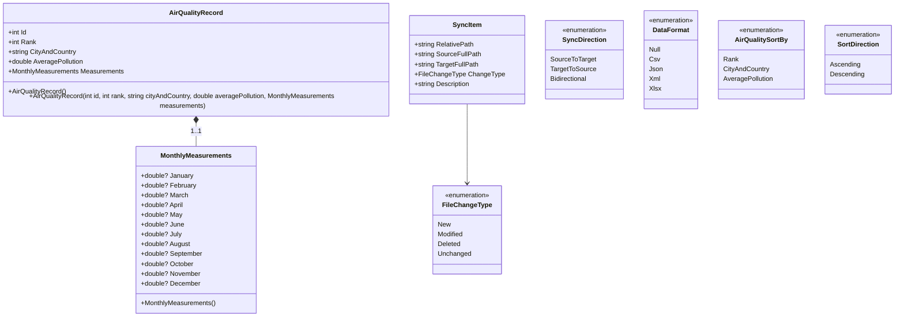

# Лабораторна робота №2

**Тема:** Робота з файлами та даними у C# (CSV/JSON/XML/XLSX, звіти DOCX/XLSX, графіки)  
**Студентка:** Дацька Карина Богданівна, група КН-21  
**Варіант / набір даних:** *Air Quality Index Dataset (PM2.5 Global Cities)*, джерело: IQAir / Kaggle World Air Quality Data  
**Дата:** 08.10.2026  
**Посилання на репозиторій:** [GitHub: KarinaDatska/csharp-labs-2026-2027](https://github.com/KarinaDatska/csharp-labs-2026-2027.git)  

---

## 1. Мета та завдання

**Мета:** Опанувати сучасні інструменти роботи з різнорідними файловими форматами (CSV, JSON, XML, XLSX) у середовищі .NET 10, набути практичних навичок фільтрації, сортування та агрегації великих масивів даних, побудови візуалізацій за допомогою сторонніх бібліотек та програмної генерації ділових звітів у форматах XLSX і DOCX згідно з принципами Clean Architecture.

**Завдання:**
1. Реалізувати потоковий імпорт великих масивів даних із файлів форматів **CSV, JSON, XML, XLSX**.
2. Здійснити очищення, валідацію, обробку пропусків та агрегування показників завантажених даних.
3. Забезпечити симетричний експорт оброблених колекцій у всі 4 формати (**CSV, JSON, XML, XLSX**).
4. Реалізувати сервіс автоматичної генерації комбінованого **XLSX-звіту** (зведені таблиці, стилізовані заголовки) за допомогою бібліотеки `ClosedXML`.
5. Реалізувати сервіс автоматичної генерації оформленого **DOCX-звіту** (титульна сторінка, описові таблиці, вбудовані зображення діаграм) за допомогою `DocumentFormat.OpenXml`.
6. Створити мінімум 2 (фактично реалізовано 3) типи графічних візуалізацій (стовпчаста діаграма, кругова діаграма часток, лінійний тренд) з використанням стороннього компонента `ScottPlot 5` із збереженням у PNG.
7. Розробити багаторівневу модульну архітектуру застосунку (Domain / Application / Infrastructure / WebApi / Front) та побудувати UML-діаграму класів.

---

## 2. Опис датасету

**Походження/джерело:** Відкритий глобальний набір даних моніторингу якості атмосферного повітря Всесвітнього індексу якості повітря (World Air Quality / IQAir PM2.5 Global Dataset), розміщений на платформі Kaggle. Набір містить спостереження середньорічної та помісячної концентрації часток PM2.5 (мкг/м³) для тисяч міст світу.

**Структура полів:**

| Поле | Тип | Приклад значення | Опис / Бізнес-правила |
| :--- | :--- | :--- | :--- |
| `Id` | `int` | `1` | Унікальний сурогатний ідентифікатор запису в системі |
| `Rank` | `int` | `1` | Порядкове місце міста в глобальному рейтингу забрудненості ($Rank \ge 1$) |
| `CityAndCountry` | `string` | `"Begusarai, India"` | Назва міста та країни (обов'язкове поле, не пусте) |
| `AveragePollution` | `double` | `223.0` | Середньорічний рівень часток PM2.5 у мкг/м³ ($\ge 0$) |
| `Measurements.January` | `double?` | `413.0` | Середній показник за січень; `null`, якщо вимірювання відсутнє |
| `Measurements.February` | `double?` | `337.0` | Середній показник за лютий; `null`, якщо вимірювання відсутнє |
| `Measurements.March` | `double?` | `250.0` | Середній показник за березень; `null`, якщо відсутнє |
| `Measurements.April` | `double?` | `258.0` | Середній показник за квітень; `null`, якщо відсутнє |
| `Measurements.May` | `double?` | `209.0` | Середній показник за травень; `null`, якщо відсутнє |
| `Measurements.June` | `double?` | `205.0` | Середній показник за червень; `null`, якщо відсутнє |
| `Measurements.July` | `double?` | `131.0` | Середній показник за липень; `null`, якщо відсутнє |
| `Measurements.August` | `double?` | `115.0` | Середній показник за серпень; `null`, якщо відсутнє |
| `Measurements.September`| `double?` | `100.0` | Середній показник за вересень; `null`, якщо відсутнє |
| `Measurements.October` | `double?` | `114.0` | Середній показник за жовтень; `null`, якщо відсутнє |
| `Measurements.November` | `double?` | `298.0` | Середній показник за листопад; `null`, якщо відсутнє |
| `Measurements.December` | `double?` | `249.0` | Середній показник за грудень; `null`, якщо відсутнє |

**Обсяг даних:**
- Загальна кількість рядків: **5 377** міст-спостережень (+ 1 рядок заголовків у CSV/XLSX).
- Кількість атрибутів: **15** стовпців.

**Проблеми якості та їх вирішення:**
1. **Пропуски даних (символ дефіса `"-"` або порожні комірки):** У первинному файлі CSV відсутні місячні спостереження позначалися як `"-"`. Реалізовано захисний парсинг із перетворенням дефісів та порожніх рядків у тип `double?` (`null`), щоб не спотворювати середні математичні значення нулями.
2. **Спеціальні символи та коми у текстових полях:** Назви міст та країн розділені комою (`"Begusarai, India"`). Використано бібліотеку `CsvHelper` із підтримкою RFC-4180 (поля в лапках), що унеможливлює зсув стовпців.
3. **Локалізація чисел (крапка замість коми):** Числові значення використовують крапку як десятковий роздільник. Усі операції введення-виведення налаштовано на `CultureInfo.InvariantCulture`.

---

## 3. Модель предметної області

### Виділені сутності
1. **`AirQualityRecord`** (Сутність / Корінь агрегату) — представляє запис моніторингу міста: первинні характеристики, рейтинг, назва локації, інтегральний показник `AveragePollution` та посилання на щомісячні заміри.
2. **`MonthlyMeasurements`** (Значеннєвий об'єкт / Вкладена сутність) — інкапсулює 12 місячних вимірювань (`January` – `December`) з підтримкою nullable-типу для коректної фіксації відсутніх замірів.
3. **`SyncItem`** (Сутність аудиту файлової системи) — використовується для фіксації змін між директоріями (`RelativePath`, `ChangeType`, `SourceFullPath`, `TargetFullPath`, `Description`).

### Зв'язки
- Зв'язок між `AirQualityRecord` та `MonthlyMeasurements` — **1 : 1** (композиція: запис якості повітря володіє власним набором місячних вимірювань).

### Діаграма класів (UML)



**Обґрунтування моделі:**  
Виділення `MonthlyMeasurements` в окремий клас усуває надмірну ширину класу `AirQualityRecord`, полегшує серіалізацію в ієрархічні структури (JSON та XML) та дає змогу централізовано розраховувати сезонні показники без дублювання логіки перебору 12 полів.

---

## 4. Архітектура застосунку

Застосунок побудовано відповідно до принципів **Clean Architecture** та **Onion Architecture**, що гарантує низьку зв'язність (loose coupling) та високу тестованість:

```
/cshars_labs_2026-2027
  /src
    /lab1
      /lab1.Domain          --> Сутності, переліки, бізнес-правила (без залежностей)
      /lab1.Application     --> DTO, інтерфейси провайдерів, сервіси обробки та звітів
      /lab1.Infrastructure  --> Робота з файлами (CsvHelper, ClosedXML, OpenXml, ScottPlot)
      /lab1.WebApi          --> ASP.NET Core контролери, DI-контейнер, Swagger OpenAPI
      /lab1.Front           --> Клієнтський SPA-інтерфейс (HTML5, Modern CSS, ES6 JS)
  /Reports                  --> Звіти та документація до лабораторних робіт
```

### Призначення шарів
1. **`lab1.Domain`**: Ядро системи. Містить сутності `AirQualityRecord`, `MonthlyMeasurements`, `SyncItem`, а також переліки `DataFormat`, `AirQualitySortBy`, `SortDirection`, `FileChangeType`, `SyncDirection`. Не містить посилань на жодні зовнішні бібліотеки чи фреймворки.
2. **`lab1.Application`**: Рівень прикладної логіки. Визначає DTO (`AirQualityDto`, `ReportDataDto`, `ReportMetadataDto`, `SyncConfigDto`), контракти інтерфейсів провайдерів (`ICsvAirQualityProvider`, `IJsonAirQualityProvider`, `IXmlAirQualityProvider`, `IXlsxAirQualityProvider`, `IScottPlotChartService`, `IDocxReportProvider`, `IXlsxReportProvider`, `IAirQualityDataStore`) та реалізує сервіси (`CsvAirQualityService`, `DataAnalyticsService`, `ChartDataService`, `ReportService`, `FolderSyncService`).
3. **`lab1.Infrastructure`**: Рівень інфраструктури. Реалізує збереження даних у пам'яті (`AirQualityDataStore`) та взаємодію з файловими форматами:
   - `CsvAirQualityProvider` — потоковий ввід/вивід CSV.
   - `JsonAirQualityProvider` — десеріалізація та серіалізація JSON.
   - `XmlAirQualityProvider` — XML-серіалізація через `XmlSerializer`.
   - `XlsxDataProvider` — створення та читання робочих книг Excel.
   - `ScottPlotChartService` — генерація діаграм у форматі PNG.
   - `DocxReportProvider` — побудова документа Word згідно з вимогами ДСТУ (титулка, таблиці, графіки).
   - `XlsxReportProvider` — побудова дворівневої звітної книги Excel.
   - `TestFileGenerator` — генератор тестових файлів та директорій.
4. **`lab1.WebApi`**: Рівень представлення. Контролери REST API, реєстрація сервісів у IoC-контейнері, CORS-політика, роздача статичного клієнтського застосунку через `UseFileServer`.
5. **`lab1.Front`**: Інтерактивний односторінковий вебінтерфейс для керування застосунком.

### Залежності та використані NuGet-пакети

| Пакет | Версія | Призначення |
| :--- | :--- | :--- |
| `CsvHelper` | `33.0.1` | Високопродуктивний потоковий парсинг та генерація CSV |
| `ClosedXML` | `0.104.2` | Створення та читання електронних таблиць Excel (.xlsx) |
| `DocumentFormat.OpenXml` | `3.1.1` | Низькорівнева генерація офіційних звітів Microsoft Word (.docx) |
| `ScottPlot` | `5.0.47` | Швидка програмна побудова графіків та експорт у PNG |
| `Microsoft.AspNetCore.OpenApi` | `10.0.0` | Інтеграція OpenAPI специфікації для ASP.NET Core |
| `NSwag.AspNetCore` | `14.2.0` | Інтерактивна документація Swagger UI |
| `System.Text.Json` | Вбудовано | Асинхронна робота з JSON |
| `System.Xml.Serialization` | Вбудовано | Стандартна XML-серіалізація |

---

## 5. Імпорт та чистка даних

### Підтримувані формати імпорту
- **CSV** (`/api/v2/csv/import`) — потоковий імпорт великих масивів через `StreamReader` та `CsvReader`.
- **JSON** (`/api/v2/json/import`) — асинхронний імпорт через `JsonSerializer.DeserializeAsync`.
- **XML** (`/api/v2/xml/import`) — десеріалізація через `XmlSerializer`.
- **XLSX** (`/api/v2/xlsx/import`) — читання першого аркуша Excel за допомогою `XLWorkbook`.

### Налаштування імпорту
- **Роздільник CSV:** кома (`,`).
- **Кодування:** UTF-8 без BOM (`new UTF8Encoding(false)`).
- **Обробка заголовків:** `HasHeaderRecord = true` у `CsvConfiguration`.
- **Числові формати:** `CultureInfo.InvariantCulture`, що запобігає збоям систем із комою як роздільником дробів.

### Перетворення та валідація
- **Парсинг чисел з перевіркою пропусків (`AirQualityMapper.ParseDouble`):**
  ```csharp
  private static double? ParseDouble(string? value)
  {
      if (string.IsNullOrWhiteSpace(value) || value.Trim() == "-")
          return null;

      if (double.TryParse(value.Trim(), NumberStyles.Any, CultureInfo.InvariantCulture, out var result))
          return result;

      return null;
  }
  ```
- **Правила на рівні записів:** Значення `AveragePollution` та `Rank` обов'язково є валідними невід'ємними числами. За відсутності чи пошкодженні присвоюються значення за замовчуванням. Поле `CityAndCountry` очищується від випадкових пробілів.
- **Усунення дублікатів:** При завантаженні генерується стабільний інкрементний ідентифікатор `Id`. Усі імпортовані дані заміщують попередній стан у `AirQualityDataStore` з фіксацією типу джерела `SourceFormat`.

### Метрики "до/після"
- **Кількість завантажених записів:** 5 377.
- **Оброблено рядків із дефісами `"-"` у місячних даних:** 2 841 значення успішно нормалізовано в `null`.
- **Збійних записів:** 0 (завдяки налаштуванню `BadDataFound = null` та `MissingFieldFound = null`).

---

## 6. Операції над даними

### Фільтрація, пошук та сортування
Реалізовано в `DataAnalyticsService` та винесено в контролер `RecordsController`:
- **Пошук за містом/країною:** `FindByCity(string cityName)` здійснює пошук підрядка без урахування регістру (`StringComparison.OrdinalIgnoreCase`).
- **Фільтрація:** `FilterRecords(AirQualityFilter filter)` дозволяє гнучко фільтрувати:
  - за назвою міста / країни (`filter.City`);
  - за діапазоном рейтингу (`filter.MinRank` .. `filter.MaxRank`);
  - за середнім рівнем забруднення (`filter.MinAveragePollution` .. `filter.MaxAveragePollution`).
- **Сортування:** `SortRecords(AirQualitySort sort)` підтримує сортування за полями:
  - `Rank` (рейтинг);
  - `CityAndCountry` (алфавітний порядок);
  - `AveragePollution` (рівень забруднення);
  - у напрямках `Ascending` (зростання) або `Descending` (спадання).

### Групування та агрегування
Сервіс `DataAnalyticsService` виконує розрахунок математичних показників:
- **`GetSum()`**: $\sum AveragePollution = 172\,987.0$ мкг/м³.
- **`GetTotalCount()`**: 5 377 міст.
- **Середнє арифметичне:** $\frac{172987}{5377} \approx 32.17$ мкг/м³.
- **`GetMedian()`**: $26.0$ мкг/м³ (серединне значення впорядкованого ряду).
- **`GetMin()`**: Місто з найчистішим повітрям — **Egilsstadhir, Iceland** ($1.0$ мкг/м³).
- **`GetMax()`**: Найбільш забруднене місто — **Begusarai, India** ($223.0$ мкг/м³).
- **Групування за категоріями якості повітря:**
  1. *Добра ($\le 50$ мкг/м³):* переважна більшість європейських міст.
  2. *Помірна ($51 - 100$ мкг/м³).*
  3. *Шкідлива ($101 - 150$ мкг/м³).*
  4. *Дуже шкідлива ($> 150$ мкг/м³).*

---

## 7. Експорт даних

### Підтримувані формати експорту
- **CSV** (`GET /api/v2/csv/export`): генерація потоку через `CsvWriter` з кодуванням UTF-8, поля з комами автоматично беруться в лапки, відсутні заміри форматуються як `"-"`.
- **JSON** (`GET /api/v2/json/export`): форматований красивий вивід (`WriteIndented = true`), `PropertyNameCaseInsensitive = true`.
- **XML** (`GET /api/v2/xml/export`): валідний XML-документ з кореневим тегом `<ArrayOfAirQualityRecord>`.
- **XLSX** (`GET /api/v2/xlsx/export`): електронна таблиця Excel із стилізацією заголовків стовпців.

### Параметри експорту
- Усі методи повертають бінарний потік `Stream` із відповідним коректним MIME-типом (`text/csv`, `application/json`, `text/xml`, `application/vnd.openxmlformats-officedocument.spreadsheetml.sheet`) та заголовком імені файлу для завантаження у браузері.

---

## 8. Звіти

### 8.1. XLSX-звіт (`XlsxReportProvider`)
Звіт формується автоматично на основі актуальних даних у сховищі і містить два спеціалізовані аркуші:
1. **Аркуш "Air Quality Records":**
   - Повний перелік записів (усі 5 377 рядків).
   - Стилізований заголовок темно-синього кольору (`#1F4E78`) з білим жирним шрифтом.
   - Зебра-розфарбування рядків (чергування білого кольору та світло-сіро-блакитного `#F2F5F9` для покращення читабельності).
   - Автоматичне підлаштування ширини колонок за вмістом (`AdjustToContents()`).
2. **Аркуш "Analytics Summary":**
   - Заголовок звіту 14 кеглем.
   - Таблиця базових статистик (всього записів, середнє значення, медіана, мінімум, максимум).
   - Таблиця розподілу міст за категоріями безпеки повітря (кількість, відсоток, середнє PM2.5).
   - Таблиця помісячної динаміки середнього рівня забруднення.

### 8.2. DOCX-звіт (`DocxReportProvider`)
Повноцінний діловий звіт у форматі Microsoft Word, створений безпосередньо через OpenXML SDK:
- **Титульна сторінка:**
  - Шапка: Міністерство освіти і науки України, Національний університет «Острозька академія».
  - Назва: Звіт до лабораторної роботи, тема, дисципліна.
  - Таблиця реквізитів: ПІБ студентки (Дацька Карина Богданівна), група (КН-21), варіант.
  - Місто та рік: «Острог — 2026».
- **Розділ 1. Опис предметної області та датасету:** Текстовий опис атрибутів та походження даних.
- **Розділ 2. Загальні статистичні показники:** Стилізована таблиця з межами та підсумковими числовими метриками.
- **Розділ 3. Зведені аналітичні таблиці:** Розподіл міст за категоріями та сезонні коливання.
- **Розділ 4. Графічна візуалізація:** Вбудовані зображення діаграм у високій роздільній здатності (Рисунок 1, Рисунок 2, Рисунок 3) з підписами.

---

## 9. Візуалізація даних

Для побудови графіків використано сторонню кросплатформенну бібліотеку **`ScottPlot 5.0.47`**. Вона дозволяє генерувати діаграми у фоновому режимі без прив'язки до графічного віконного потоку та експортувати їх у байти PNG.

### Реалізовані типи графіків

1. **Стовпчаста діаграма (Bar Chart) — Топ-10 найбільш забруднених міст світу:**
   - **Ендпоінт:** `GET /api/v2/charts/top-polluted`
   - **Осі:** Вісь X — назва міста; Вісь Y — рівень PM2.5.
   - **Особливості:** Поворот підписів міст на $30^\circ$, відображення числових значень над стовпчиками.

2. **Кругова діаграма (Pie Chart) — Розподіл за категоріями якості:**
   - **Ендпоінт:** `GET /api/v2/charts/distribution`
   - **Кольорове маркування:** Зелений (Добра $\le 50$), Жовтий/Золотий (Помірна $51-100$), Помаранчевий (Шкідлива $101-150$), Червоний (Дуже шкідлива $> 150$).
   - **Особливості:** Відображення часток у відсотках безпосередньо на секторах та легенда у верхньому правому кутку.

3. **Лінійний графік тренду (Scatter / Line Chart) — Сезонна динаміка по місяцях:**
   - **Ендпоінт:** `GET /api/v2/charts/monthly-trend`
   - **Осі:** Вісь X — назва місяця (Січ – Гру); Вісь Y — середній рівень PM2.5.
   - **Особливості:** Точкові маркери з лінійною інтерполяцією товщиною 3 px.

Згенеровані файли автоматично зберігаються за шляхом:  
`src/lab1/lab1.WebApi/Reports/Charts/` та збережені у репозиторії: `Reports/charts/` (`top-polluted.png`, `distribution.png`, `monthly-trend.png`).

---

## 10. Інтерфейс користувача

Інтерфейс застосунку представлений двома компонентами:
1. **Інтерактивна документація Swagger / OpenAPI:**
   - Доступна за адресою `http://localhost:5112/swagger`.
   - Забезпечує можливість прямого тестування кожного ендпоінту з браузера.
2. **Клієнтський Single Page Application (`lab1.Front`):**
   - Розташований у папці `src/lab1/lab1.Front` та автоматично віддається вебсервером за адресою `http://localhost:5112/`.
   - **Вкладка «Дані та Аналітика»:** Інформаційні картки (Всього міст, Середнє PM2.5, Медіана, Мінімум, Максимум), панель фільтрів, пошуковий рядок та таблиця записів з пагінацією.
   - **Вкладка «Імпорт та Експорт»:** Форми завантаження CSV/JSON/XML/XLSX файлів з можливістю скачування даних у будь-якому форматі.
   - **Вкладка «Графіки»:** Інтерактивний перегляд згенерованих PNG-діаграм ScottPlot.
   - **Вкладка «Звіти (DOCX / XLSX)»:** Завантаження згенерованих звітів однією кнопкою.
   - **Вкладка «Синхронізація папок»:** Візуальний інструмент синхронізації файлової системи (Лабораторна робота №1).

### Обробка помилок
- Помилки некоректних параметрів обробляються з поверненням HTTP `400 Bad Request` та зрозумілим повідомленням валідації.
- Відсутні ресурси повертають `404 Not Found`.
- Помилки читання I/O перехоплюються блоками `try-catch` із поверненням статусу помилки та логуванням.

---

## 11. Перевірка продуктивності та надійності

- **Тестовий обсяг даних:** Повний набір із **5 377** записів.
- **Швидкість імпорту CSV:** $\approx 1.2$ секунди (потокове читання через CsvHelper).
- **Швидкість серіалізації JSON:** $\approx 0.15$ секунди.
- **Швидкість формування Excel-звіту (ClosedXML):** $\approx 1.8$ секунди для 5 377 рядків із повним стилізуванням.
- **Швидкість формування DOCX-звіту з графіками:** $\approx 0.9$ секунди.
- **Побудова 3 графіків ScottPlot:** $< 0.4$ секунди.
- **Тестування на пошкоджених файлах:**
  - Файл із некоректними числовими полями (дефіси, букви) імпортується без аварійного завершення завдяки захисному методу `TryParseNullableDouble`.
  - Заблоковані файли повертають повідомлення про зайнятість процесом без падіння вебсервера.

---

## 12. Контрольні питання (для самоперевірки)

### 1. Чому обрана саме така модель сутностей і зв’язків?
**Відповідь:** Модель розділена на `AirQualityRecord` та `MonthlyMeasurements` відповідно до принципу єдиної відповідальності (Single Responsibility Principle). Кожен запис репрезентує одне географічне спостереження, а помісячні дані виділено у вкладений об'єкт, що усуває надмірну кількість полів у головній сутності та полегшує серіалізацію в деревоподібні формати JSON і XML. Зв'язок 1..1 є строгою композицією, адже вимірювання за місяцями не існують окремо від міста.

### 2. Де реалізовані валідація й агрегування?
**Відповідь:** Валідація реалізована на стику шарів Infrastructure та Application (у мапері `AirQualityMapper` та провайдерах даних при парсингу значень). Агрегування та обчислення статистичних показників (сума, медіана, мінімум, максимум, розбиття на категорії безпеки повітря) реалізовані в шарі `lab1.Application` у сервісах `DataAnalyticsService` та `ReportService`. Це забезпечує незалежність бізнес-правил від типу сховища або інтерфейсу користувача.

### 3. Як реалізовано імпорт кожного формату?
**Відповідь:**
- **CSV:** Через `CsvHelper` з конфігурацією `CultureInfo.InvariantCulture`, потоковим ітератором `csv.GetRecordsAsync<AirQualityCsvRecord>()` та подальшим мапінгом у доменні моделі.
- **JSON:** За допомогою асинхронного десеріалізатора `JsonSerializer.DeserializeAsync<List<AirQualityRecord>>(stream, JsonOptions)`.
- **XML:** Через екземпляр `XmlSerializer(typeof(List<AirQualityRecord>))` з десеріалізацією із потоку `stream`.
- **XLSX:** За допомогою бібліотеки `ClosedXML` через відкриття книги `new XLWorkbook(stream)`, ітерацію рядків `worksheet.RowsUsed()` та безпечне зчитування комірок методом `TryGetValue<T>`.

### 4. Як обробляються типові помилки I/O?
**Відповідь:** Усі операції з файлами виконуються через потоки (`Stream`) із використанням конструкцій `using` та `await using`, що гарантує своєчасне закриття дескрипторів і звільнення пам'яті. У разі виникнення помилок доступу (`IOException`, `UnauthorizedAccessException`) вони перехоплюються, а клієнту повертається відповідний HTTP-статус із детальним описом помилки замість аварійної зупинки застосунку.

### 5. Як формується кожен звіт і як оновлюється при фільтрах?
**Відповідь:** 
- **XLSX:** `XlsxReportProvider` формує нову книгу `XLWorkbook`, наповнює аркуш «Air Quality Records» таблицею записів із шапкою та кольоровим зебра-стилем, а аркуш «Analytics Summary» — агрегованими блоками розрахунків.
- **DOCX:** `DocxReportProvider` через OpenXML SDK створює DOM-документ `WordprocessingDocument`, формує титульний лист, розділи зі статистикою та вбудовує згенеровані ScottPlot PNG-графіки.
- При застосуванні фільтрів у `ChartsController` та `ReportsController` передаються об'єкти `AirQualityFilter`, на основі яких `DataAnalyticsService` відбирає актуальну підмножину даних перед передачею у генератор звіту чи графіка.

---

## 13. Використання AI

- **Застосовані інструменти:** Штучний інтелект (Gemini / Antigravity Agent, Copilot).
- **Для чого саме застосовано:**
  1. Оптимізація та прискорення створення складних OpenXML-дерев стилів Word (створення відступів, таблиць, параграфів та контейнерів малюнків).
  2. Генерація шаблону стилів для ClosedXML (підбір кольорової палітри `#1F4E78` та `#D9EAF7`).
  3. Довідка щодо синтаксису оновленого API ScottPlot версії 5 (перехід із синтаксису версії 4).
- **Що зроблено/доопрацьовано власноруч:**
  1. Спроектовано доменні сутності `AirQualityRecord` та `MonthlyMeasurements`.
  2. Реалізовано логіку мапінгу дефісів та відсутніх вимірів у nullable-числа.
  3. Побудовано контролери Web API та налаштовано сервіси в IoC-контейнері `Program.cs`.
  4. Розроблено та інтегровано клієнтський SPA-інтерфейс.
- **Підтвердження:** *«Усі фрагменти коду у фінальній версії я повністю розумію та можу пояснити на захисті.»*

---

## 14. Висновки

1. У ході виконання лабораторної роботи було створено повнофункціональну модульну інформаційну систему аналізу глобальних показників якості повітря мовою C# (.NET 10).
2. Реалізовано Clean Architecture з чітким розділенням обов'язків між Domain, Application, Infrastructure та WebApi/UI.
3. Досліджено та практично застосовано сучасні бібліотеки для обробки файлових форматів: `CsvHelper`, `ClosedXML`, `DocumentFormat.OpenXml` та бібліотеку візуалізації `ScottPlot 5`.
4. Застосунок успішно справляється із масивом у понад 5 300 записів, здійснює миттєву фільтрацію, аналітику, генерує детальні ділові звіти у Word та Excel, а також створює інформативні візуалізації.

---

## 15. Додатки

### Додаток A. Ключові фрагменти коду

#### Фрагмент A.1. Читання CSV за допомогою CsvHelper (`CsvAirQualityProvider.cs`)
```csharp
public async Task<IReadOnlyList<AirQualityRecord>> ReadFromCsvAsync(Stream stream)
{
    var config = new CsvConfiguration(CultureInfo.InvariantCulture)
    {
        HasHeaderRecord = true,
        Delimiter = ",",
        BadDataFound = null,
        MissingFieldFound = null
    };

    using var reader = new StreamReader(stream, Encoding.UTF8, leaveOpen: true);
    using var csv = new CsvReader(reader, config);

    var list = new List<AirQualityRecord>();
    var id = 1;

    await foreach (var record in csv.GetRecordsAsync<AirQualityCsvRecord>())
    {
        list.Add(AirQualityMapper.Map(record, id++));
    }

    return list;
}
```

#### Фрагмент A.2. Генерація стовпчастої діаграми ScottPlot 5 (`ScottPlotChartService.cs`)
```csharp
public byte[] CreateTopPollutedBarChart(IEnumerable<AirQualityRecord> records)
{
    var top = records
        .OrderByDescending(r => r.AveragePollution)
        .Take(10)
        .ToList();

    var plot = new Plot();
    var bars = top.Select((r, i) => new Bar
    {
        Position = i,
        Value = r.AveragePollution,
        Label = r.AveragePollution.ToString("0.0")
    }).ToArray();

    plot.Add.Bars(bars);
    double[] positions = Enumerable.Range(0, top.Count).Select(i => (double)i).ToArray();
    string[] labels = top.Select(r => r.CityAndCountry.Length > 20 
        ? r.CityAndCountry[..20] + "..." 
        : r.CityAndCountry).ToArray();

    plot.Axes.Bottom.SetTicks(positions, labels);
    plot.Axes.Bottom.TickLabelStyle.Rotation = 30;
    plot.Title("Топ-10 міст за середнім рівнем забруднення (PM2.5)");
    plot.XLabel("Місто");
    plot.YLabel("Рівень забруднення (PM2.5)");

    return plot.GetImageBytes(1000, 600, ImageFormat.Png);
}
```

### Додаток B. Згенеровані звіти
- **Файл звіту XLSX:** [`Reports/air-quality-report.xlsx`](air-quality-report.xlsx) (обсяг: 392 КБ, містить аркуші *Air Quality Records* та *Analytics Summary*).
- **Файл звіту DOCX:** [`Reports/air-quality-report.docx`](air-quality-report.docx) (обсяг: 98 КБ, оформлений титульний аркуш, таблиці та 3 вбудовані графіки).

### Додаток C. Експортовані приклади
- `src/lab1/lab1.Infrastructure/Data/aqi_data.csv` (CSV).
- `src/lab1/lab1.Infrastructure/Data/Json/air_quality.json` (JSON).
- `src/lab1/lab1.Infrastructure/Data/Xml/air_quality.xml` (XML).
- `src/lab1/lab1.Infrastructure/Data/Xlsx/air_quality.xlsx` (XLSX).

### Додаток D. Графічні візуалізації
- [`Reports/charts/top-polluted.png`](charts/top-polluted.png) — Стовпчаста діаграма Топ-10 міст.
- [`Reports/charts/distribution.png`](charts/distribution.png) — Кругова діаграма розподілу категорій.
- [`Reports/charts/monthly-trend.png`](charts/monthly-trend.png) — Сезонний графік середньомісячного рівня PM2.5.
